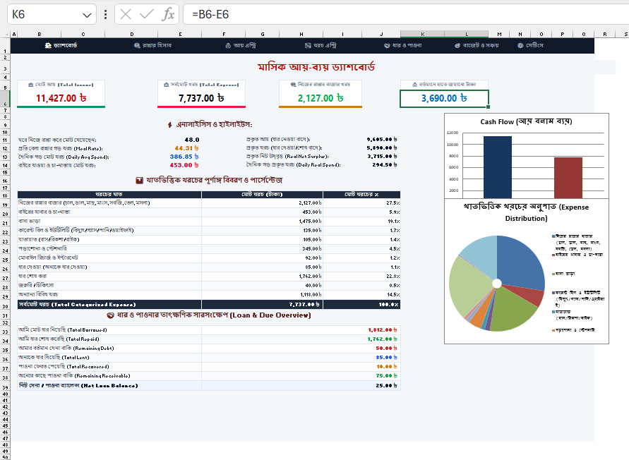
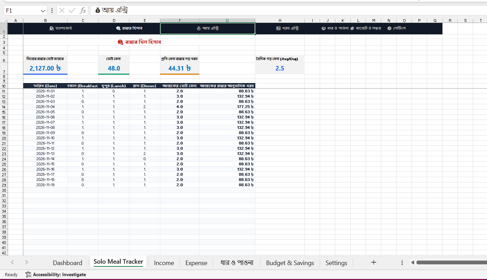
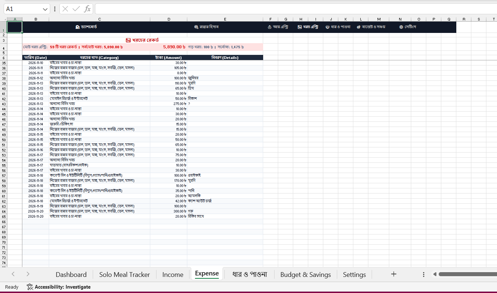
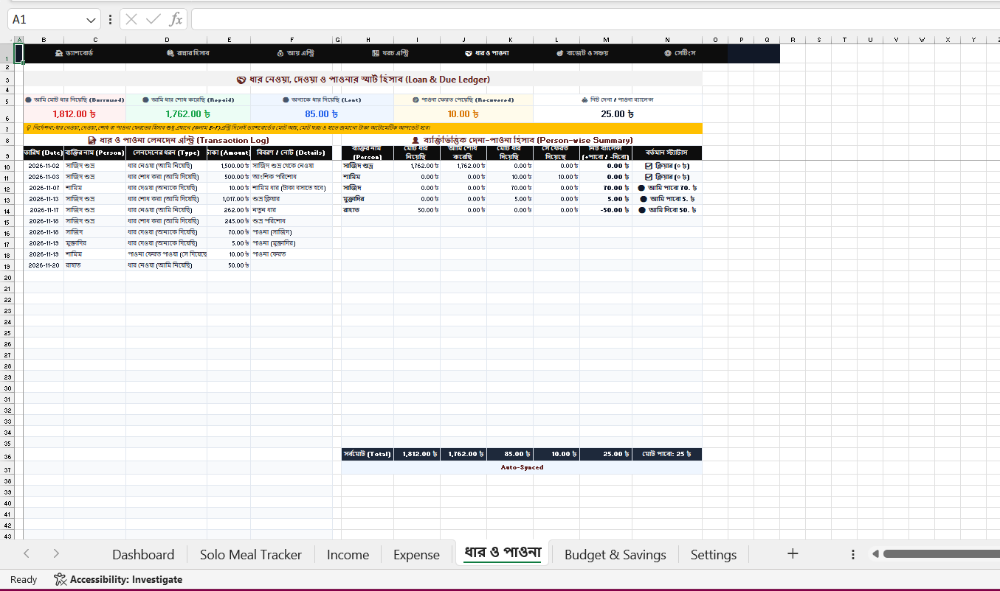
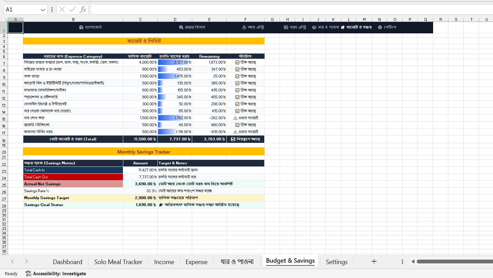
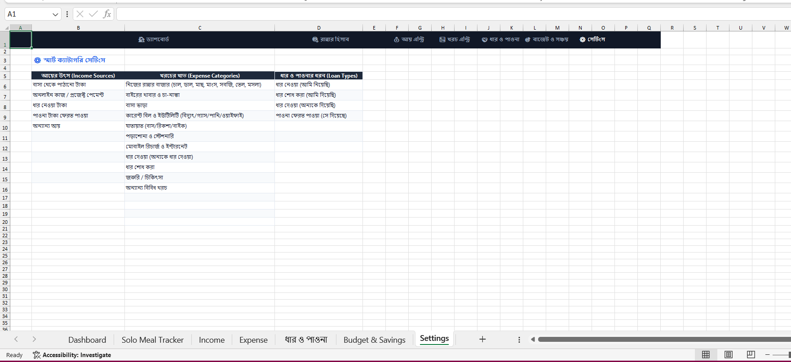

# 📊 Personal Finance, Meal & Loan Management System (Microsoft Excel)

An all-in-one, automated **Personal Finance, Solo Meal Costing, Loan/Receivable Ledger, and Budget Control System** built in native Microsoft Excel (`.xlsx`). Designed with an executive UI, custom top-navigation bar, bilingual (English & Bangla) labels, and zero-macro dynamic formula architecture for maximum compatibility and reliability.

---

## 🎯 Project Overview

Managing daily cash flow, shared or solo meal rates, personal borrowings/lendings, and monthly category budgets across scattered notes often leads to financial leakage. This workbook centralizes all daily transactions into a single relational-style Excel model that updates KPIs, visual charts, person-wise debt balances, and budget alerts in real time.

---

## 🗂️ Workbook Architecture (7 Integrated Worksheets)

| # | Worksheet Name | Core Function |
| :--- | :--- | :--- |
| **1** | **`Dashboard`** | Executive summary featuring 4 primary KPI cards, Real vs. Cash Flow metrics, category-wise expense breakdown table, Loan & Due overview, and dynamic charts. |
| **2** | **`Solo Meal Tracker`** | Tracks daily meals (Breakfast, Lunch, Dinner), automatically computes per-meal cost (`Meal Rate`), daily meal averages, and estimated daily food cost. |
| **3** | **`Income`** | Structured log for recording all incoming funds categorized by source (family allowance, freelance/project payments, loan inflows, recoveries). |
| **4** | **`Expense`** | Granular daily expense ledger tracking date, category, amount, and transaction notes with automated summary statistics (`Total`, `Count`, `Average`, `Max`). |
| **5** | **`ধার ও পাওনা` (Loan & Due Ledger)** | Dual-panel ledger combining a chronological transaction log with an auto-synced **Person-wise Summary** tracking Borrowed, Repaid, Lent, Recovered, and Net Balance. |
| **6** | **`Budget & Savings`** | Category-level budget limits vs. actual spending with Excel Data Bars, dynamic status indicators (`ঠিক আছে` / `ওভার বাজেট`), and a Monthly Savings Target tracker. |
| **7** | **`Settings`** | Centralized control panel storing master lists for Income Sources, Expense Categories, and Loan Types that feed dynamic Data Validation dropdowns across the workbook. |

---

## ✨ Key Features & Engineering Highlights

* **Executive KPI & Real-Cash Separation:** Distinguishes total cash movement from **Real Income** (excluding borrowed money) and **Real Spend** (excluding loan repayments) to reflect true financial health.
* **Automated Meal Rate Engine:** Dynamically links grocery expenses (`নিজের রান্নার বাজার`) from the `Expense` sheet with total meal counts in `Solo Meal Tracker` to calculate exact per-meal costs without manual recalculation.
* **Person-Wise Loan & Receivable Reconciliation:** Uses multi-criteria conditional aggregation to automatically compute individual balances and flag settlement status (`ক্লিয়ার`, `আমি পাবো`, `আমি দিবো`).
* **Visual Budget Control & Savings Goal Tracking:** Combines variance formulas, conditional Data Bars, and automated goal-achievement alerts (`অভিনন্দন! মাসিক সঞ্চয় লক্ষ্য অর্জিত হয়েছে`).
* **App-Like Navigation & Data Integrity:** Features a unified dark-navy header navigation bar across all 7 sheets and strict dropdown validation governed by the `Settings` tab.

---

## 🛠️ Excel Formulas & Techniques Demonstrated

* **Conditional Aggregation:** `SUMIFS` for multi-criteria category spending, meal grocery linking, and person-wise loan/receivable summaries.
* **Logical & Error-Proofing Functions:** Nested `IF` and `IFERROR` statements for budget status flags, loan settlement statuses, and zero-division protection on meal/savings rates.
* **Statistical Summary Functions:** `SUM`, `COUNT`, `AVERAGE`, and `MAX` for real-time ledger header metrics.
* **Data Visualization & UI:** Column charts (Cash Flow), Pie charts (Expense Distribution), Conditional Formatting Data Bars, custom currency formatting (`৳`), and freeze-pane layouts.

---

## 📸 Workbook Preview

### 1. Executive Dashboard

### 2. Solo Meal Tracker

### 3. Expense Ledger

### 4. Loan & Receivable Ledger (ধার ও পাওনা)

### 5. Budget & Savings Control

### 6. Smart Category Settings

---

## 🚀 How to Use

1. **Download** the `.xlsx` workbook from this repository and open it in **Microsoft Excel (Desktop 2016 or later / Microsoft 365)**.
2. **Customize Categories:** Go to the **`Settings`** tab to add or edit your Income Sources, Expense Categories, and Loan Types.
3. **Set Monthly Limits:** Open **`Budget & Savings`** to define your monthly category budgets and savings target.
4. **Log Daily Activity:** Record daily entries in **`Income`**, **`Expense`**, **`Solo Meal Tracker`**, and **`ধার ও পাওনা`**. All KPIs, person-wise balances, and **`Dashboard`** charts will update automatically.

---

## 👤 Author & Contact

**MD. RIFAT HOSEN**  
*B.Sc. in Apparel Engineering | Excel Automation, CRM & Data Reporting Specialist*  

* **LinkedIn:** [linkedin.com/in/rifat-hosen-00880b40b](https://www.linkedin.com/in/rifat-hosen-00880b40b)  
* **Email:** rifathosen608877@gmail.com  
* **Location:** Gopalganj, Bangladesh
